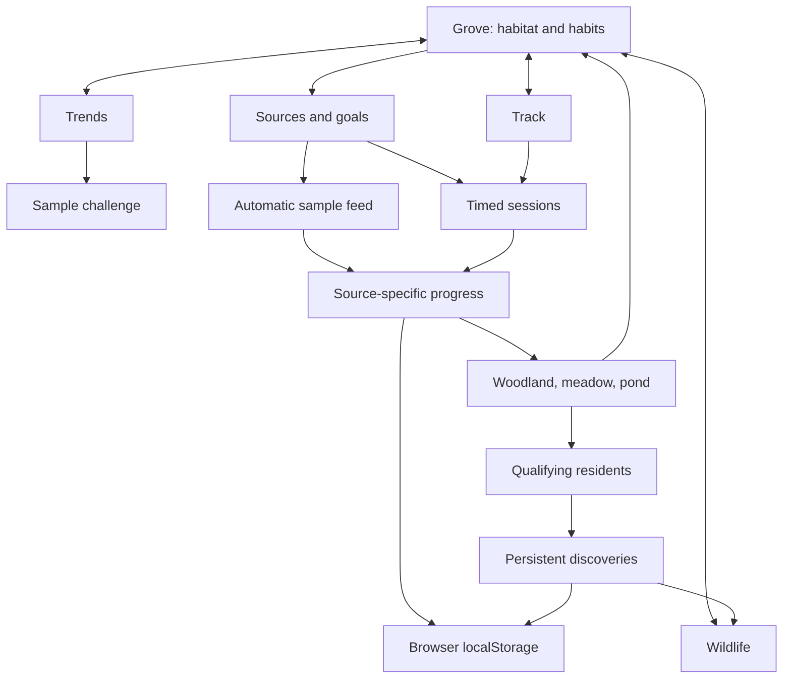

# Grove — habitat and tracking design

Grove is a phone-first browser prototype for balancing movement, rest, and screen time. Each habit shapes a distinct part of one landscape. Biodiversity makes balance visible; three separate habit indicators keep the underlying values readable. Open `schematic.html` for the visual screen map.

## Screens and interactions

| Destination | Behavior |
| --- | --- |
| Grove | Reactive woodland, meadow, and pond; current habit progress; biodiversity and the next discovery |
| Track | Walk, rest, or focus timer; start, pause, resume, and finish; elapsed minutes |
| Wildlife | Species guide with habitat rules; persistent discoveries and current residents |
| Trends | Separate habit charts and averages; source context; access to the sample improvement challenge |
| Sources | Switch Demo sources or Timed sessions; run or replay the automatic demo day |
| Goal sheets | Edit targets without entering habit amounts |
| Counted apps | Include or exclude simulated apps from the demo screen total |
| Settings | Sources, goals, schematic, and reset confirmation |

Grove, Track, Wildlife, and Trends use bottom navigation. Sheets hold configuration close to its context. No screen asks users to type steps, sleep totals, or app-usage amounts.

## Two explicit data sources

**Demo sources** simulates wearable and screen feeds. A deterministic 30-second day moves through four stages at 0, 10, 20, and 30 seconds: all three habitats at 25%, movement complete, rest complete, then screen balance complete. It ends with all three goals met. Values update automatically; replay starts the sequence again. These records are visibly labeled samples and are not presented as a device connection.

**Timed sessions** measures elapsed walk, rest, and focus time. Only one session runs at once. Pause stops credited time; resume continues it; finish preserves elapsed activity. Running time appears in progress before a session is finished. Goals default to 20 walk minutes, 480 rest minutes, and 25 focus minutes and can be changed.

| Mode | Movement value | Rest value | Screen balance value |
| --- | --- | --- | --- |
| Demo sources | Sample steps | Sample sleep minutes | Sample counted app minutes |
| Timed sessions | Elapsed walk minutes | Elapsed rest minutes | Elapsed focus minutes |

The two sources retain separate values. A timed walk never creates a step count. A rest timer never creates detected sleep. A focus timer never creates phone-wide screen usage. Labels and units change with the source.

Timer records use timestamps, reconcile after reload or foreground changes, and retain pause state. Each session snapshots its countdown target at start; daily-goal edits do not retroactively shorten it. Automatic completion credits through that target, even after a delayed background wake-up. Elapsed time crossing midnight is allocated to the corresponding local dates, with daily activity credit capped at 24 hours. There is no accelerated timer in Timed sessions; the short automatic feed is confined to Demo sources.

## Three habitats, one landscape

| Habit | Habitat | Visible life |
| --- | --- | --- |
| Movement | Woodland | Trees, undergrowth, and woodland visitors |
| Rest | Meadow | Flowers, small animals, and sheltered visitors |
| Screen balance | Pond | Water plants, fish, and waterside visitors |

Each habitat responds to that habit's current normalized progress. Common plants establish individual habitats. Animals require combinations of progress, so completing one habit cannot fill the landscape alone. Fox, deer, heron, and otter reward a mix of habitat conditions. The wildlife guide displays each species' specific rule.

The biodiversity score is the lowest of the three normalized progress values, expressed from 0 to 100. It is a game mechanic for balance, not a health score. Four level labels translate it into a visible direction: Taking root below 25%, Finding balance from 25%, Growing together from 60%, and Thriving from 90%. The next species adds a concrete goal.

**Current residents** qualify from the current day's active source. **Discoveries** accumulate in `ecosystem.discoveredIDs` and remain in the guide across later days and source changes. The app does not erase a past discovery when today's conditions change. The landscape can welcome that species again when its needs are met. Otter requires all three goals; Demo sources also requires the sample day to be finished.

The model uses these normalized thresholds; the scene represents their qualifying species with original SVG art.

| Species | Conditions |
| --- | --- |
| Oak | Movement at least 20% |
| Wildflowers | Rest at least 25% |
| Fish | Screen balance at least 35% |
| Pine | Movement 65% and rest 35% |
| Fern | Movement 45% and screen balance 35% |
| Rabbit | Rest 65% and movement 40% |
| Frog | Screen balance 65% and rest 40% |
| Butterfly | Rest 75%, movement 45%, screen balance 55% |
| Fox | Movement 85%, rest 80%, screen balance 70% |
| Deer | Every habit at least 90% |
| Heron | Screen balance 100%, movement and rest at least 95% |
| Otter | Every goal met; Demo sync day finished |

Woodland progress controls tree density and size. Meadow progress controls grass, flowers, and ferns. Pond progress expands the water and supporting plants. Species add their specific animals and plant forms; subtle fish and butterfly motion respects reduced-motion preferences.

## Visual decisions

Forest informs the quiet green canvas, warm earth tones, large visual stage, clear timer, and one main action. Grove uses original illustrations and its own identity. The reactive habitat replaces a static reward image: plants and visitors appear where their supporting habit belongs.

Large values, short labels, and clear controls take priority. The scene tells a story at a glance; the wildlife guide explains discovery rules when opened. Source context stays visible without filling the home screen with technical details. Three habit rows preserve the notes' emphasis on balance.

The verified classic screenshots are from September 2022. A later walkthrough follows Forest through November 2023, version 4.71.0. These sources guide an adaptation; they do not establish an exact reproduction of every 2023 screen. Current official pages may show later features.

## Challenge behavior

The challenge is available in Demo sync. Its points compare normalized sample progress against personal goals over the last seven days and the previous seven. Each habit has equal weight and is capped at 100%. Missing history produces a pending score. Sample peers are labeled; joining sends no invitation or data. Points are a game mechanic, not a validated clinical measure.

## Implementation and storage

`model.js` owns sources, dates, timer arithmetic, progress, discoveries, rewards, migration, and storage recovery. `scene.js` renders the responsive habitat and species. `app.js` renders screens and handles interactions. HTML, CSS, and local SVG artwork provide the interface.

Version 2 keeps the existing `grove-local-v1` localStorage key and migrates earlier state. Tracking mode, sessions, goals, discoveries, and preferences remain in the browser. Reset uses an explicit confirmation. A static server or GitHub Pages serves the app; no app account or backend is required. `scripts/build_site.py` validates relative references and stages only public files, including `scene.js`.

## Browser and native boundaries

The browser prototype measures session duration and runs a simulated data feed. It does not verify physical activity or sleep, connect to wearables, read phone-wide usage, monitor other apps, or block them. A timer continuing after a tab loses focus is elapsed time, not proof of what the user did during it. Friends are sample profiles; there are no accounts, invitations, messages, or cloud sync. LocalStorage is not a production health-data security architecture.

A native release would need platform-specific health and screen-time integrations, user authorization, source reconciliation, and a separate privacy design. [Apple's Screen Time framework](https://developer.apple.com/documentation/screentime) and [Android Health Connect](https://developer.android.com/health-and-fitness/health-connect) are platform references for that later work; neither is connected here.

Feature requirements come from the project notes: balance, Forest-style gamification, personal goals, improvement-based competition, app exclusions, and later native tracking. Clinical and legal claims from the notes are not app assertions. Forest reference links and date caveats appear in `schematic.html`.
