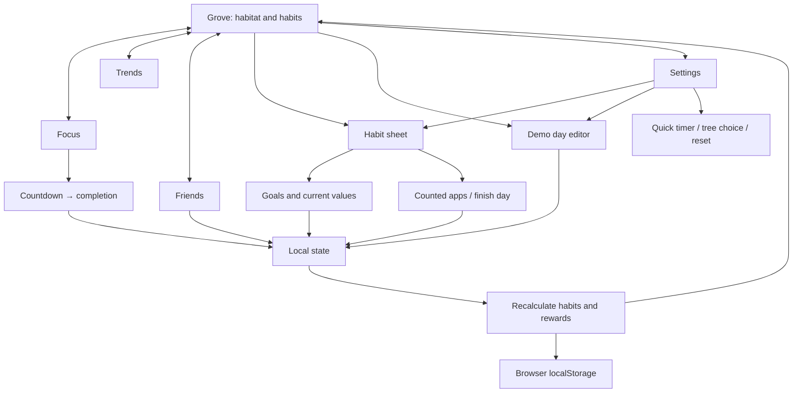

# Grove — implemented design

Grove is a phone-first browser prototype for balancing screen time, movement, and sleep. The visual habitat makes effort tangible; three habit indicators keep each goal visible. Open `schematic.html` for the visual screen map.

## Screens and interactions

| Destination | Implemented behavior |
| --- | --- |
| Grove | Original forest scene; tree and visitor counts; three habit totals and progress bars; one next action |
| Focus | 5–120 minute timer in 5-minute increments; Unplug, Study, or Create tag; start, pause, resume, cancel, complete; tree-name selection |
| Trends | Seven-day chart, daily average, goal line; switch Movement, Sleep, or Screen time; daily completion grid |
| Friends | Local challenge; fixed sample peers; join or leave; own points calculated from saved records |
| Habit sheets | Edit current steps or sleep, goals, and screen limit; add 2,000 demo steps; finish or reopen the day |
| Counted apps | Include or exclude sample apps; recalculate counted minutes immediately |
| Demo day | Edit steps, sleep, six app-usage values, and day-finished status |
| Collection / tree choice | Totals and recent rewards; Oak, Pine at 10 trees, Blossom at 15 trees |
| Settings | Goals, exclusions, tree choice, quick timer, demo editor, schematic, reset confirmation |

Four primary destinations use bottom navigation. Sheets keep edits close to their context. Tree selection stores and displays the chosen species. The next-action rule prioritizes movement, then sleep, then focus. It is a fixed rule, not an adaptive recommendation engine.

## Visual decisions

Forest informs the green focus canvas, dominant tree or habitat, warm earth tones, clear timer, and one main action. Grove uses original illustrations and its own identity. Source analysis and date caveats appear in `schematic.html`.

Values and the timer take priority. Short status labels replace explanatory paragraphs. Three habit rows and an “x / 3 goals” count support the notes' emphasis on balance. There is no combined health score.

## Sample state

The initial grove has eight trees and two visitors as illustrative history. Today starts at 6,240 steps, 8 h 10 m sleep, and 2 h 20 m counted screen time. Default goals are 8,000 steps, 8 hours sleep, and a 3-hour screen limit. They are editable game defaults, not medical recommendations.

Instagram, TikTok, and YouTube initially count. Canvas, Google Docs, and Music are excluded. All app minutes remain stored, so toggles change the total using actual arithmetic. Thirteen past sample dates plus today provide the fourteen records needed for the challenge. A later new local date begins with zero values. Today's initial sleep claim is already included in the seeded grove. Reset restores this full sample state after confirmation.

## Rewards and scoring

- Movement goal: steps at or above the chosen goal.
- Sleep goal: sleep minutes at or above the chosen goal.
- Screen goal: day marked finished and counted usage at or below the chosen limit.
- Each habit awards one tree per date; all three award one visitor per date.
- Each completed focus session awards one tree per unique session ID.

Persisted claim IDs prevent duplicate rewards. Earned rewards remain when records are later reduced or the day is reopened. Screen time requires day completion so being under the limit early does not prematurely award its tree.

```text
movement = min(1, steps / stepGoal)
sleep    = min(1, sleepMinutes / sleepGoal)
screen   = min(1, screenLimit / max(1, countedMinutes))
day      = mean(movement, sleep, screen)
points   = 100 × (mean(last 7 days) − mean(previous 7 days))
```

The last seven days include today. All fourteen records are required. Each habit has equal weight and is capped at 100%. Screen attainment can be full while today is open, but its tree still requires finishing the day. Current goals and exclusions apply to both weeks; changing them recalculates both periods.

Points measure change in percentage points against personal goals. They are a game mechanic, not a validated health score. Peer scores are fixed examples. Joining adds the user's locally calculated row and sends no invitation or data.

## Local data model

```text
State (version 1)
  goals: { steps, sleep: minutes, screen: minutes }
  excluded: [appId]
  days: { YYYY-MM-DD: { date, steps, sleep, usage: { appId: minutes }, closed } }
  rewards: { trees, visitors, claims: [date:habit], visitorDates, focusIds, log }
  focus: null | { id, minutes, tag, status, total, remaining, endsAt, accelerated }
  selectedTree, joined, focusMinutes, focusTag, demoSpeed
```

State persists as `grove-local-v1` in browser `localStorage`. Focus uses an end timestamp, reconciled on load, foreground changes, and periodic updates. Pausing stores remaining time. Cancelling clears the session without awarding a tree. Optional quick demo mode uses one real second per chosen focus minute and cannot change during an active session.

`model.js` owns arithmetic, dates, initial data, rewards, storage loading, and timer completion. `app.js` renders views and handles events. HTML, CSS, and local SVG assets provide the interface. A static server or GitHub Pages serves the files. The publishing script stages only the public app files. No app account or backend is required.

## Screen and data flow



## Boundaries and sources

This prototype uses sample and manually entered records. It does not connect to wearables or health platforms, read phone-wide usage, monitor other apps, or block apps. Those features need separate native platform integrations and permissions. Friends are sample profiles; there are no invitations, accounts, messages, or cloud sync. The shared habitat illustration does not place individual new trees as totals grow. Local storage is not presented as a production security architecture.

Feature requirements come from the user's “Pasted text.txt” notes: balance, Forest-style gamification, personal goals, improvement-based competition, app exclusions, and a later native implementation. Clinical and legal claims from the notes are not app assertions. Forest reference links and their date caveats appear in `schematic.html`.
